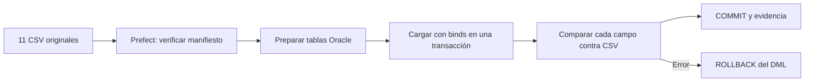

# Invacom: staging Oracle con Prefect

Proyecto 1 de Minería de Datos, UTN, 3C2026. Entrega del área de staging:
**11 CSV, 15.607 registros**, conservados sin limpieza ni conversión de valores.

Prefect orquesta la lectura, la preparación de tablas, la carga, la comparación
de cada campo y la evidencia. Los CSV originales están en `data/raw/` y sus
SHA-256 en `data/manifest.json`. La limpieza y el modelo dimensional continúan
desde estas tablas con el trabajo del compañero.



## Datos conservados

Cada columna fuente es `VARCHAR2`, incluidos identificadores, fechas e importes:
así se mantienen ceros iniciales, representación decimal, espacios y Unicode.
No hay `TRIM`, redondeos, deduplicación ni valores inventados. `CSV_ROW_NUMBER`
identifica cada registro desde 1, después del encabezado, y conserva su orden.
Para leer en el orden original se debe usar `ORDER BY CSV_ROW_NUMBER`.

**Oracle representa las cadenas vacías como `NULL`.** Esta es la correspondencia
esperada para un campo vacío del CSV. El literal `NULL`, si aparece como texto,
se conserva como texto. Los archivos originales preservan también comillas,
codificación y saltos de línea byte por byte. Véanse
[las decisiones](docs/decisiones.md) y [el inventario](docs/fuentes.md).

## Ejecutar con Prefect

Requisitos: Python 3.11 o superior y acceso a una PDB Oracle con `AL32UTF8`.
Se probó con Python 3.13 y Oracle XE 21c, servicio `XEPDB1`.
El usuario requiere `CREATE SESSION`, `CREATE TABLE` y cuota en su tablespace.
No se debe conectar el flujo como `SYS` ni `SYSTEM`.

Desde PowerShell, dentro de esta carpeta:

```powershell
py -3.13 -m venv .venv
.\.venv\Scripts\python.exe -m pip install -r requirements.txt
```

Si usas otra instalación compatible de Python, úsala para crear `.venv`.
Las versiones exactas del entorno validado también están en
`requirements-lock.txt`; se pueden instalar con `pip install -r requirements-lock.txt`.

Para una instalación local nueva de Oracle XE en Windows, el siguiente paso
opcional crea **solo** `INVACOM_STG` en `XEPDB1` y cifra su contraseña con tu
cuenta Windows. Requiere que `sqlplus.exe` esté en PATH y que tu usuario tenga
autenticación OS como administrador Oracle. Se detiene si el usuario ya existe.

```powershell
.\setup-local-oracle.ps1
.\run.ps1
```

Si el esquema ya está preparado, configura tu conexión y ejecuta el flujo.
`run.ps1` pide la contraseña de forma oculta cuando hace falta:

```powershell
$env:ORACLE_USER = 'TU_USUARIO_STAGING'
$env:ORACLE_DSN = 'localhost:1521/XEPDB1'
.\run.ps1
```

En otros sistemas, define `ORACLE_USER`, `ORACLE_PASSWORD` y `ORACLE_DSN` en el
entorno y ejecuta `python scripts/staging_flow.py`. La contraseña no se pasa
como parámetro de Prefect ni se incluye en Git.

La primera ejecución crea 12 tablas: 11 fuentes y `STG_SOURCE_FILE` como
manifiesto. Inserta los datos con `executemany` y bind variables. Antes del
`COMMIT`, relee **cada campo de cada fila** y lo compara con los CSV. También
verifica sus hashes, orden y conteos. Ante errores se revierte todo el DML.
El DDL de Oracle puede dejar tablas vacías si falla la instalación.

La carga requiere tablas vacías; no borra ni reemplaza datos. Una ejecución
posterior se usa para validar lo que ya está cargado:

```powershell
.\run.ps1 -ValidateOnly
```

Si la tarea de evidencia falla después del `COMMIT`, los datos ya fueron
confirmados: ejecuta `-ValidateOnly` para generar la evidencia pendiente.
El flujo y sus tareas no tienen reintentos automáticos ni caché de resultados.

## Ver ejecuciones en la interfaz de Prefect

Sin un API configurado, Prefect inicia su servidor temporal para la ejecución.
Para conservar historial y mostrarlo durante la sustentación, usa un servidor
local persistente. En una terminal del proyecto:

```powershell
$env:PREFECT_HOME = Join-Path (Get-Location) 'local\prefect'
$env:PREFECT_SERVER_ANALYTICS_ENABLED = 'false'
.\.venv\Scripts\prefect.exe server start --host 127.0.0.1
```

En otra terminal del mismo proyecto:

```powershell
$env:PREFECT_API_URL = 'http://127.0.0.1:4200/api'
.\run.ps1 -ValidateOnly
```

Abre `http://127.0.0.1:4200`. Para las siguientes ejecuciones usa siempre ese
`PREFECT_HOME` y API. No hace falta Prefect Cloud para esta entrega.

## Comprobar archivos y SQL

Estas comprobaciones no necesitan conexión a Oracle:

```powershell
.\.venv\Scripts\python.exe scripts/profile_sources.py --check
.\.venv\Scripts\python.exe scripts/generate_sql.py --check
.\.venv\Scripts\python.exe -m unittest discover -s tests -v
```

Para regenerar evidencia y SQL tras un cambio de fuente **revisado por el equipo**:
`python scripts/profile_sources.py` y después `python scripts/generate_sql.py`.
Revisa el diff y las longitudes del esquema antes de cargar nuevos CSV.

Los scripts `sql/` permiten revisar la implementación y comprobar en SQL*Plus
el contenido mediante SHA-256 por fila. Para una instalación manual alternativa
en **otro esquema vacío**, conectado con tu usuario staging en SQL*Plus o
SQL Developer (Ejecutar script / F5):

```sql
@"C:/RUTA/proyecto-oracle/sql/00_install.sql"
```

No ejecutes la instalación manual sobre la carga realizada con Prefect. Para
auditar esa carga se puede ejecutar `03_validate_data.sql` en una sesión dedicada.
La evidencia de la herramienta asignada se obtiene ejecutando el flujo Prefect.

## Compartir y colaborar

Consulta [la guía de entrega](docs/colaboracion.md). El repositorio incluye los
CSV y el código; `local/`, `.venv/` y las contraseñas están excluidos de Git.
Cada compañero debe configurar su propia conexión, porque la credencial cifrada
local solo funciona con la cuenta Windows que la creó.

La ejecución real y sus comprobaciones están descritas en
[el avance de staging](docs/avance-staging.md), con archivos de evidencia.

Los commits registran avances reales por entregable. Los avances semanales,
aportes de otros integrantes y tablero Kanban deben mantenerse durante las
semanas restantes. Varios commits de hoy no equivalen a varias semanas de trabajo.

Referencias: [flujos y tareas de Prefect](https://docs.prefect.io/v3/how-to-guides/workflows/write-and-run),
[carga por lotes en python-oracledb](https://python-oracledb.readthedocs.io/en/v3.4.2/user_guide/batch_statement.html),
[cadenas vacías en Oracle](https://docs.oracle.com/en/database/oracle/oracle-database/21/sqlrf/Nulls.html).
